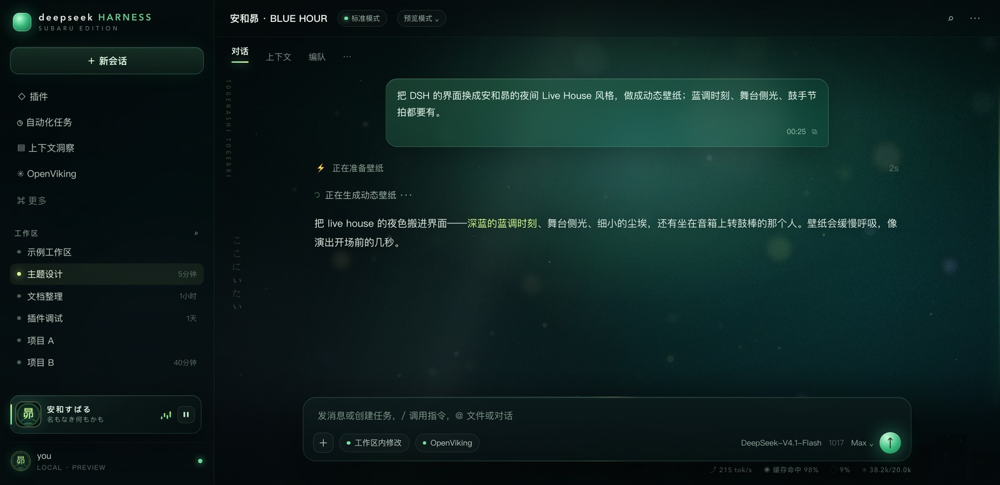

# 安和昴 / BLUE HOUR

> GitHub: https://github.com/stephqin686/dsh-subaru-theme

A fan-made, night-live-house skin for **DeepSeek Harness** — blue-hour city bokeh, stage light, drifting dust and a green edge light that breathes at 104 BPM.

> **No official or fan artwork is included in this repository.** The demo uses an original abstract placeholder generated by `tools/make-placeholder.py`. See [关于壁纸](#关于壁纸重要) before adding your own image.



---

## 这是什么

这是一个纯客户端的 DSH 主题插件，不会改模型、会话或数据：

- 重写 DSH Web GUI 的 `--dsw-*` 颜色 token：深色烟熏玻璃、绿色交互色、夜间代码块、菜单、滚动条、选区、焦点环。
- 给界面铺一层 7 层叠加的动态壁纸：缓慢推拉、鼠标视差、Canvas 尘埃/散景、舞台侧光、胶片颗粒、节拍边线。
- 左下角加一张 Now Playing 卡片：头像、角色名、曲名、EQ、暂停键。
- 强制使用夜间调色板；DSH 设置里的浅色主题不会覆盖它。

主题的视觉方向来自《Girls Band Cry》的鼓手 **安和昴（安和すばる / Awa Subaru）**：蓝调时刻、城市灯光、Live House 的冷色，以及她的个人色绿色。代码和占位素材是原创的；角色和作品版权归各自权利人所有。

---

## 关于壁纸（重要）

这个仓库**不包含**任何动画截图、官方视觉图或同人图。

原因很简单：这张主题最初使用的屋顶夜景来自壁纸站，页面没有标注原作者，无法确认公开分发授权。所以公开仓库只带一张**程序生成的原创占位壁纸**（深蓝/青绿渐变、城市剪影、散景和一个很淡的光晕），它足够把玻璃、绿色 token 和动效展示出来，但不会复制别人的画。

想换成自己的图：

```sh
# 1920×1080 的 JPG，放在 assets/wall.jpg
# 正方形头像 JPG，放在 assets/avatar.jpg
python3 build.py
```

`assets/wall.jpg` 和 `assets/avatar.jpg` 默认被 `.gitignore` 忽略，不会误提交。**请只使用你有权使用的图片**；如果你要公开发布自己的版本，请先确认作者授权。

---

## 设计

### 颜色

| 角色 | 颜色 | 用途 |
|---|---|---|
| 昴的应援色 | `#6fe3a1` / `#d6ff8f` | 主按钮、焦点、选中、滚动条、播放器 |
| 蓝调时刻 | `#05090b` / `#0b1a1c` | 背景、玻璃面板、代码块 |
| 城市霓虹 | `#9d94ff` / `#ff8fa7` | 少量紫/粉环境光 |
| 文字 | `#eef7f0` / `#b9ccc2` / `#8ba096` | 三级文字层级 |

绿色对应昴的个人色，只给“可交互”的东西；蓝色只做环境，避免整屏都在发光。

### 动态壁纸

不是一张静态图铺底，而是 7 层轻量动画：

1. **54 秒缓慢推拉**：壁纸以极慢的速度放大、平移，像手持镜头。
2. **鼠标视差**：人物/背景随指针产生 7–9px 的反向位移。
3. **Canvas 尘埃/散景**：26 颗大散景 + 54 颗细尘，向上漂浮、闪烁。
4. **舞台侧光**：一条斜向光束以 19 秒周期扫过。
5. **胶片颗粒 + 半调网点**：接近动画手绘赛璐璐的质感。
6. **104 BPM 边线脉冲**：右侧一条 2px 绿色 LED 边线，按鼓手节拍轻微呼吸；播放器 EQ 同步。
7. **跟随光斑**：指针附近一团很淡的绿色舞台光。

性能：Canvas DPR 上限 1.5，页面隐藏时暂停，`prefers-reduced-motion` 下自动静止。播放器右下角的暂停键可以停掉所有动画，状态记在 `localStorage`。

### 界面

- 侧栏、输入框、用户气泡是 **深色烟熏玻璃**：半透明 + `backdrop-filter`。
- 主色 token 全部重写（`--dsw-*`），包括按钮、链接、代码块、选区、焦点环、滚动条、菜单、toast、diff。
- 用户气泡是绿色玻璃，助手正文无底色，只靠壁纸暗部承托。
- 左下角 **Now Playing 卡片**：头像、`安和すばる`、`名もなき何もかも`、EQ、暂停键。
- 画面左侧一行很淡的竖排 `TOGENASHI TOGEARI` 和 `ここにいたい`，像 Live House 墙上的手写标语。
- 竖排歌词用 **Yuji Syuku** 毛笔字体（子集化后约 9KB）；正文仍是系统字体。

---

## 快速开始

需要：DSH 桌面版或 Web profile、Python 3.8+（只用标准库）。

### 1. 构建

```sh
git clone https://github.com/stephqin686/dsh-subaru-theme.git
cd dsh-subaru-theme
python3 build.py
```

构建会生成：

- `preview/theme.css`、`preview/boot.js`（本地预览用）
- `dsh-theme-subaru/lib/client.js`（内联了 CSS、JS、字体和壁纸的客户端 bundle）

`build.py` 会优先使用 `assets/wall.jpg` / `assets/avatar.jpg`；没有就用仓库里的 `*.placeholder.jpg`。

### 2. 挂载到 DSH

主题是一个本地 link 插件。以桌面 profile 为例：

```sh
PROFILE="$HOME/.dsh/profiles/desktop"

mkdir -p "$PROFILE/node_modules"
ln -sfn "$PWD/dsh-theme-subaru" "$PROFILE/node_modules/dsh-theme-subaru"
```

在 `$PROFILE/cordis.patch.yml` 末尾追加：

```yaml
- insert:
    - id: theme-subaru
      name: dsh-theme-subaru
```

如果这个文件目前只有一行空数组 `[]`，把 `[]` 整个替换成上面的列表。Web profile 把 `desktop` 换成 `web` 即可。

然后重启 DSH，或刷新 GUI 窗口。插件不是 npm 包、也不是插件市场条目，只是当前 profile 的一个普通客户端插件行。

> 如果之后在 Plugins 页安装/更新其他插件时软链被 pnpm 当成 extraneous 清理，重新执行上面的 `ln -sfn` 即可；想永久保留可以改成 `pnpm add link:<绝对路径>`。

### 3. 关闭 / 更新

关闭：把 patch 行改成 `disabled: true`，刷新窗口；或删除整段 `insert`。

更新：改 `src/theme.css` / `src/theme.js` 后重新 `python3 build.py`，刷新窗口。直接改 `lib/client.js` 不会热更新（除非你正在跑 `pnpm run dev:web`）。

### 本地预览

```sh
open preview/index.html
```

预览页模拟了 DSH 的侧栏、对话和输入框，用的是同一套 `theme.css` / `boot.js`。

---

## 文件结构

```
.
├── README.md
├── LICENSE                    # MIT（代码）
├── .gitignore
├── build.py                   # 打包成 preview + client bundle
├── src/
│   ├── theme.css              # token、玻璃、壁纸层、播放器
│   └── theme.js               # DOM、Canvas、视差、节拍、暂停
├── assets/
│   ├── wall.placeholder.jpg   # 原创占位壁纸（1920×1080）
│   ├── avatar.placeholder.jpg # 原创占位头像（昴字徽章）
│   ├── yuji-sub.woff          # 子集化 Yuji Syuku（OFL）
│   └── OFL.txt                # 字体许可证
├── tools/
│   └── make-placeholder.py    # 生成占位壁纸/头像（Pillow + numpy）
├── dsh-theme-subaru/
│   ├── package.json
│   └── lib/
│       ├── index.js           # Host 半：空 apply
│       └── OFL.txt
└── preview/
    ├── index.html             # 模拟 DSH 布局的预览
    ├── screenshot.jpg         # 本 README 的截图（占位壁纸）
    └── plugin-test.html       # 只测 client bundle 的测试页
```

`dsh-theme-subaru/lib/client.js`、`preview/theme.css`、`preview/boot.js`、`preview/wall.jpg`、`preview/avatar.jpg` 是构建产物，已在 `.gitignore` 中；`assets/wall.jpg`、`assets/avatar.jpg` 也默认忽略，避免把个人图片或版权素材提交上去。

---

## 自定义

- **换壁纸**：把自己的 1920×1080 JPG 放到 `assets/wall.jpg`，正方形头像放到 `assets/avatar.jpg`，重新构建。
- **换颜色**：改 `src/theme.css` 顶部的 `--sw-*` 和 `--dsw-*` token。
- **换文案**：播放器文字在 `src/theme.js` 的 `PLAYER_HTML`；左侧竖排字在 `WALL_HTML`。
- **关掉某些动效**：在 `src/theme.css` 里删掉对应 keyframes，或在 `src/theme.js` 里把 `paused` 默认设为 `true`。

---

## 版权与许可

- **代码**（CSS/JS/Canvas/构建脚本）：MIT，见 [LICENSE](LICENSE)。
- **占位壁纸/头像**：由 `tools/make-placeholder.py` 生成，视为本项目原创，随代码以 MIT 提供。
- **Yuji Syuku 字体**：SIL Open Font License 1.1，子集化后仅保留装饰用字；许可证见 [assets/OFL.txt](assets/OFL.txt)。
- **角色与作品**：《Girls Band Cry》及安和昴 / Togenashi Togeari 的名称与形象归其权利人所有。本项目是非商业同人主题，与官方无关联，不包含官方视觉图或同人图。
- **你自己的壁纸**：请只使用你有权使用的图片；仓库默认忽略 `assets/wall.jpg` / `assets/avatar.jpg`，避免误分发。

---

## 致谢

- 角色与音乐灵感来自《Girls Band Cry》。
- 毛笔字体来自 [Yuji Syuku](https://fonts.google.com/specimen/Yuji+Syuku)（SIL OFL）。
- 主题代码、占位素材与文档为本项目原创。
